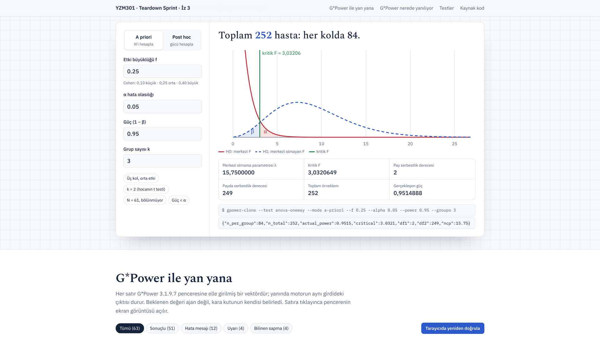
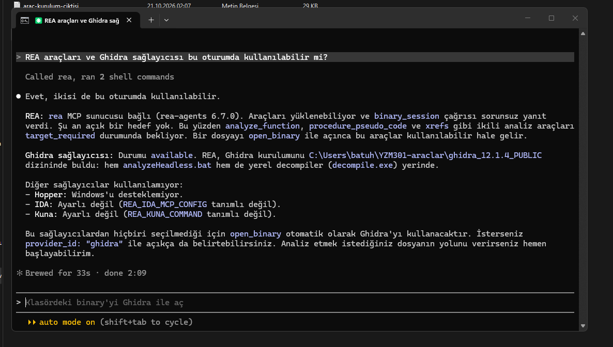
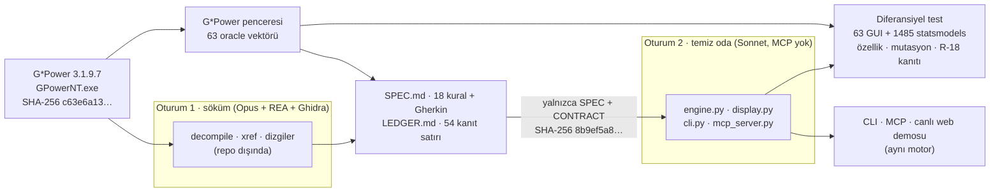

# anova-oneway — güç analizi motoru (temiz oda yeniden yazımı)

YZM301 Yazılım Gerçekleme ve Test · Teardown Sprint / Ödev 5 · Dr. Öğr. Üyesi Nurettin Şenyer
**İz 3 · F testi, tek yönlü ANOVA (üç tedavi kolu)** · a priori + post hoc

Bu depo, G*Power 3.1.9.7'nin *"F tests → ANOVA: Fixed effects, omnibus, one-way"*
hesabının davranışını kara kutu olarak inceleyip (REA + Ghidra), kanıta bağlı bir
spesifikasyondan **bağımsız olarak yeniden yazılmış** bir hesap motorudur. G*Power'ın
kendisi değildir, onun kodunu içermez ve onun adını taşımaz.

**Yazar:** Batuhan Gelegen ([@bgelegen](https://github.com/bgelegen))

[](https://github.com/bgelegen/gpower-anova-teardown/actions/workflows/test.yml)

**▶ [Canlı demo](https://bgelegen.github.io/gpower-anova-teardown/)** — aynı Python motoru tarayıcınızda çalışır, 63 G*Power penceresiyle yan yana ·
[60 sn CLI demosu](docs/demo-cli.mp4) · [Tanıtım videosu](docs/tanitim.mp4)

[](https://bgelegen.github.io/gpower-anova-teardown/)

> **Atıf.** G*Power: Faul, F., Erdfelder, E., Lang, A.-G., & Buchner, A. (2007). G*Power 3: A
> flexible statistical power analysis program for the social, behavioral, and biomedical
> sciences. *Behavior Research Methods, 39*(2), 175–191. · Faul, F., Erdfelder, E., Buchner, A.,
> & Lang, A.-G. (2009). Statistical power analyses using G*Power 3.1: Tests for correlation and
> regression analyses. *Behavior Research Methods, 41*(4), 1149–1160. G*Power ücretsizdir ve
> yalnızca [resmî sayfasından](https://www.psychologie.hhu.de/arbeitsgruppen/allgemeine-psychologie-und-arbeitspsychologie/gpower)
> dağıtılır; bu depo onu dağıtmaz.

## Sonuçlar bir bakışta

| | Sonuç |
|---|---|
| G*Power GUI oracle | **63 vektör** (ekran görüntülü) · 59'u tüm alanlarıyla birebir · **N birebir 47/51 = %92,2** |
| Bilinen sapma | V52, V54, V55, V56 (f ≤ 0,0002, df2 ≳ 2·10⁸) — G*Power'ın N'i bu vektörlerde **minimum değil** (V54'te hedefin altında); 40 basamaklı bağımsız hesapla kanıtlandı. Motor scipy 1.18'de hepsinde doğru, eski scipy'de df2 ≈ 10⁹'da o da kayıyor (H-09) → [`oracle/R18_YUKSEK_HASSASIYET.md`](oracle/R18_YUKSEK_HASSASIYET.md) |
| Kütüphane oracle | statsmodels, **1485 / 1485** (a priori N birebir, post hoc \|Δgüç\| < 1e-6) |
| Hata/uyarı metinleri | 12 / 12 hata kutusu, 4 / 4 "Please note" uyarısı birebir |
| Test paketi | **1768 test**: 1764 geçti, 4 `xfail(strict)` (bilinen sapma) · Windows + Linux, Python 3.10 ve 3.13'te CI (CI matrisi H-09'u yakaladı) |
| Özellik tabanlı test | 8 değişmez (metamorfik ilişki), derin koşuda **16 000 rastgele girdi** — [`tests/test_properties.py`](tests/test_properties.py) |
| Mutasyon testi | **25 / 26 mutant öldürüldü** (%96, yaşayan tek mutant eşdeğer); ilk kampanya **2 gerçek test açığı** buldu, kapatıldı — [`MUTATION.md`](MUTATION.md) |
| Canlı demo | GitHub Pages + Pyodide: **depodaki motorun kendisi** tarayıcıda; 63 vektörü diferansiyel testin aynı koduyla tarayıcıda yeniden doğrular |
| Kanıt defteri | 54 satır: **23 [REA]** (kılavuzda olmayan davranış), 6 [REA→DOK] puan dışı, 7 [DOK], 18 [ORACLE]/[AJAN] |
| MCP (+15) | tek araç `anova_oneway`; 51 girdide MCP nesnesi = CLI JSON'u |
| AI ajanı (+10) | 10 Türkçe klinik soru; son sürüm iki koşuda **19/20**, 20 yanıtta kaynaksız sayı yok; MCP–GUI token ölçümü |
| Demo | [`docs/demo-cli.mp4`](docs/demo-cli.mp4) (58 sn, CLI koşusunun ekran kaydı) |

## İncelenen sürüm (konfigürasyon yönetimi)

| Alan | Değer |
|------|-------|
| Yazılım | G*Power 3.1.9.7 (Windows) |
| Dosya | `GPowerNT.exe` (dosya sürümü 3.1.9.7) |
| **SHA-256** | `c63e6a133eb6372932f810c08cc33dc35a06d1ddb658f897bd6c34a754efc812` |
| Paket | `GPowerWin_3.1.9.7.zip` · SHA-256 `3bb7f1f2478d74ee5ba701ae7f849373cf2b8a11f6b6216c7c6b236db7861199` |
| Kılavuz | `GPowerManual.pdf` · SHA-256 `cde1293c99dac2a5da7fa9cf660fb3c1ad16e58fdc973823545cd3ec40c8249f` |
| Kaynak | psychologie.hhu.de (resmî sayfa) |

Yürütülebilir dosya, kılavuz PDF'i ve decompile çıktıları bu depoda **yoktur** (`.gitignore`).

| Araç | Sürüm |
|------|-------|
| REA (`rea-agents`, npm) | 6.7.0 (207 MCP aracı) |
| Ghidra | 12.1.4 · JDK Eclipse Temurin 21 |
| Ajan | Claude Code 2.1.305 (O1 Opus, O2 Sonnet, değerlendirme Haiku) |



*Ajanın "REA araçları ve Ghidra sağlayıcısı bu oturumda kullanılabilir mi?" sorusuna yanıtı.*

## Kurulum

Python ≥ 3.10.

```bash
git clone https://github.com/bgelegen/gpower-anova-teardown.git
cd gpower-anova-teardown
python -m venv .venv
# Windows: .venv\Scripts\activate    Linux/macOS: source .venv/bin/activate
pip install -e ".[test]"        # motor + CLI + MCP + test bağımlılıkları (scipy, mcp, pytest, mpmath)
```

Yalnızca CLI için `pip install -e .` yeterlidir (tek bağımlılık `scipy`).

## Çalıştırma

```bash
gpower-clone --test anova-oneway --mode a-priori --f 0.25 --alpha 0.05 --power 0.95 --groups 3
{"n_per_group":84,"n_total":252,"actual_power":0.9515,"critical":3.0321,"df1":2,"df2":249,"ncp":15.75}

gpower-clone --test anova-oneway --mode post-hoc --f 0.25 --alpha 0.05 --n-total 60 --groups 3
{"n_per_group":20,"n_total":60,"actual_power":0.3744,"critical":3.1588,"df1":2,"df2":57,"ncp":3.75}

gpower-clone --test anova-oneway --mode a-priori --f 0.25 --alpha 0.05 --power 0.03 --groups 3
{"error":"Power must be greater than or equal to alpha."}        # çıkış kodu 2
```

- Tek satır JSON; ondalıklı alanlar varsayılan 4 hane (yönergedeki örnekle aynı),
  `--digits 7` G*Power penceresinin 7 hanesini verir.
- Bayrak ve alan adları **geçicidir** (yönergedeki CONTRACT bağlantısı boştu):
  [`CONTRACT.md`](CONTRACT.md). Tek değiştirme noktası `src/gpower_clone/contract.py`;
  yaygın takma adlar (`--k`, `--n`, `--effect-size`, `apriori`, …) zaten kabul edilir.

```bash
pytest -q                       # 1768 test (~2 dk); oracle dosyaları yoksa diferansiyel testler atlanır
```

## Temiz oda akışı



- O2, repo dışında yalnızca `SPEC.md`, `CONTRACT.md` ve boş MCP yapılandırması içeren bir
  klasörde (`logs/oturum2-baslangic-klasoru.txt`), `--strict-mcp-config` ile **sıfır MCP
  sunucusuyla** ve web araçları kapalı çalıştı. Akışı: `logs/oturum2.jsonl` (41 tur; klasör
  dışına erişim yok — araç çağrıları tarandı).
- O2'nin gördüğü SPEC'in SHA-256'sı (`logs/oturum2-spec-sha256.txt`) bu depodaki `SPEC.md`
  ile aynıdır; SPEC sonradan değiştirilmedi. O2 sonrası bulgular yalnızca `LEDGER.md`
  L-47–L-54'e eklendi.
- O2 sonrası koda yapılan değişiklikler (açıklama için): MCP aracına `warnings` alanı
  (CONTRACT v0.3, ajan uyarıyı görebilsin diye) ve açıklamasına sayı biçimi notu, `--test` takma adları (v0.4), V54–V56'nın
  `xfail` listesine eklenmesi ve `tests/test_r18_high_precision.py`. Motor (`engine.py`) ve
  gösterim (`display.py`) O2'nin yazdığı gibidir.
- O1'in akışı REA'nın decompile çıktılarını içerdiği için repoya konmadı.

## Teslim dosyaları

| Dosya | İçerik |
|-------|--------|
| [`SPEC.md`](SPEC.md) | 18 kural (R-01…R-18) + Gherkin kabul kriterleri + bilinmeyenler |
| [`LEDGER.md`](LEDGER.md) | Kanıt defteri: iddia · REA kanıtı (fonksiyon/adres) · güven · bilinmeyen · SPEC · test |
| [`HALLUCINATIONS.md`](HALLUCINATIONS.md) | 9 kayıt: ajanların yanlış çıkardıkları, nasıl fark edildi, hangi test yakaladı |
| [`AGENT_COST.md`](AGENT_COST.md) | Oturum başına ölçülmüş token, süre, liste maliyeti, kota |
| [`MUTATION.md`](MUTATION.md) | Mutasyon testi: 26 mutant, hangi testin yakaladığı, bulunan iki test açığı |
| [`tools/`](tools/) | `mutasyon.py` (mutasyon kampanyası), `build_site.py` (canlı demoyu üretir) |
| [`SPEC_SORULARI.md`](SPEC_SORULARI.md) | O2'nin SPEC'te belirsiz bulduğu 13 nokta ve kararları |
| [`prompts/`](prompts/) | O1 ve O2'nin ilk prompt'ları (birebir) + O1 devam mesajı |
| [`oracle/`](oracle/) | 63 G*Power vektörü (CSV + ekran görüntüsü), 1485 statsmodels vektörü, R-18 kanıtı |
| [`src/gpower_clone/`](src/gpower_clone/) | `engine.py` (saf hesap) · `display.py` (G*Power gösterimi) · `contract.py` · `cli.py` · `mcp_server.py` |
| [`tests/`](tests/) | kural testleri (her R-xx ve Gherkin senaryosu), CLI, diferansiyel, MCP=CLI, R-18 |
| [`eval/`](eval/) | AI ajanı: 10 soru, araç çağrısı logları, sonuçlar, token karşılaştırması ([`eval/OZET.md`](eval/OZET.md)) |
| [`docs/`](docs/) | Canlı demo sitesi (GitHub Pages), videolar, terminal kaydı ve betiği, MCP şeması |

## Bulunan, kılavuzda olmayan davranışlar (öne çıkanlar)

| Davranış | Kanıt |
|----------|-------|
| N yalnızca yukarı değil, **grup sayısının katına** yuvarlanır: ⌈N_ham/k⌉·k (f = 0,25, k = 3 → 251 değil 252) | L-09 [REA] · V05, V15–V17, V63 |
| Kök sürekli N üzerinde Brent ile aranır; taban aralık [k+1, k+100], ×1,6 ile **sınırsız** genişler, durma \|yarı aralık\| ≤ 2⁻⁵³·\|b\|, en çok 300 iterasyon; verilen 1e-10 toleransı **okunmaz** | L-07, L-08, L-10, L-13 [REA] |
| Kök bulucu başarısız olursa hata yok; N alt sınıra kıskaçlanır → a priori en küçük N = 2k; güç = α hata değil, N = 2k | L-11, L-14, L-20, L-23 · V23, V24, V47 |
| Geçerlilik sırası ve birebir mesaj metinleri; a priori f ∈ [1e-6, 50], post hoc f ∈ [0, 50] | L-15–L-21 [REA] · V25, V28–V33, V40, V49, V50, V57 |
| Post hoc'ta N k'ya bölünmüyorsa hesap verilen N ile yapılır + "Please note" uyarısı | L-22 [REA] · V38, V39, V41, V58 |
| Kesirli k ve N sessizce yarım-yukarı yuvarlanır (2,5 → 3, 1,4 → 1 → hata) | L-35 [REA] · V45, V46, V58–V60 |
| Gösterim: 0,01 < \|x\| < 100 → `%.7f`, aksi `%.7g`; tamsayılar ≥ 10¹² → `%.5g` | L-25, L-26 [REA] · V23, V39, V47, V48, V56, V61, V62 |
| Uç küçük f'de G*Power'ın merkezi olmayan F hesabı kayar; V54'te gösterilen N hedef gücü **sağlamıyor** | L-37 [REA], L-47, L-48 · V52, V54–V56 |

## Canlı demo

**https://bgelegen.github.io/gpower-anova-teardown/** — tek sayfa, kurulum gerektirmez.

- **Hesaplayıcı:** `src/gpower_clone/` paketinin kendisi [Pyodide](https://pyodide.org) (tarayıcıda
  CPython + scipy) ile çalışır; CLI ve MCP'den sonra üçüncü ince adaptördür. Sonuçlar G*Power
  penceresindeki gibi 7 haneyle, F dağılımları G*Power'ın renkleriyle çizilir; altında aynı girdinin
  CLI komutu ve JSON çıktısı görünür.
- **G*Power ile yan yana:** 63 vektör, süzgeçler (hata, uyarı, bilinen sapma), satıra tıklayınca
  G*Power penceresinin ekran görüntüsü ve alan alan karşılaştırma.
- **Tarayıcıda yeniden doğrula:** diferansiyel testin **aynı** karşılaştırma kodu (`tests/helpers.py`)
  63 vektörü tarayıcıda yeniden koşar.
- Senkron güvencesi: `tests/test_site_sync.py`, `docs/py/` altındaki dosyaların `src/` ile birebir
  aynı olduğunu denetler; site `python tools/build_site.py` ile üretilir.

## MCP sunucusu (+15)

```bash
gpower-clone-mcp            # stdio MCP sunucusu, tek araç: anova_oneway
```

Claude Code / Claude Desktop yapılandırması:

```json
{ "mcpServers": { "gpower": { "command": "gpower-clone-mcp", "args": [] } } }
```

**Araç şeması** (`anova_oneway`, tam hâli [`docs/mcp-schema.json`](docs/mcp-schema.json)):

| Parametre | Tip | Not |
|-----------|-----|-----|
| `mode` | string | `a-priori` \| `post-hoc` (takma adlar CLI ile aynı) |
| `f` | number | Cohen f |
| `alpha` | number | α |
| `power` | number | yalnızca a priori |
| `groups` | number | k |
| `n_total` | number | yalnızca post hoc |
| `digits` | number | isteğe bağlı, varsayılan 4 |

Dönüş: CLI'nin yazdığı JSON nesnesinin **aynısı** (aynı `cli.evaluate` + aynı biçimlendirme;
sunucu kendi hesabını yapmaz) ya da `{"error": …}`. CLI'nin stderr'e yazdığı uyarılar,
ajan görebilsin diye nesnenin sonunda `warnings` listesi olarak döner. Araç açıklaması sayıların
ondalık **nokta** ile gönderilmesini ister (Türkçe ajanların `"0,25"` alışkanlığı, H-07).
Eşitlik testi: `tests/test_mcp_equality.py` — gerçek stdio istemcisiyle 51 girdi (geçerli + geçersiz).

## AI ajanı (+10)

Türkçe klinik soru → MCP çağrısı → Türkçe yanıt; ajan **hiç hesap yapmaz** (yerleşik araçları
kapalı, yanıttaki her sayı araç çıktısında geçmek zorunda). 10 soruluk set, tam araç çağrısı
logları ve ölçülmüş MCP/GUI token karşılaştırması: [`eval/OZET.md`](eval/OZET.md).

| Koşu | Sonuç | Not |
|------|------:|-----|
| v1 | 8/10 | Ajan iki yanıtta sayıyı kendisi yuvarladı ("≈0,37", "%47") → HALLUCINATIONS H-05 |
| v2 | 10/10 | Sistem mesajı sıkılaştırıldı (bağlamda ortamın eklediği ilgisiz araçlar da vardı) |
| v3a | 4/10 | Bağlamda yalnızca `anova_oneway`: ajan `"0,25"` gibi ondalık virgül gönderdi → H-07 |
| **v3** | **10/10** | Araç açıklaması: "sayıyı ondalık nokta ile gönder" — son sürüm |
| v3 tekrar | 9/10 | Aynı ayarlar; S09'da ajan "tek kollu" çalışmada grup sayısını 2 varsaydı → H-08 |

İsteğe bağlı "Jev" System-1 sınıflandırıcısı bu teslimde **yoktur**; kapsam dışı soru (S10,
t-testi) ajanın kendisi tarafından reddedilir ve araç çağrılmaz.

## Demo

[`docs/demo-cli.mp4`](docs/demo-cli.mp4) — 58 sn, 1920×1080: CLI koşusunun ekran kaydı
(a priori 252, k = 2 → hocanın referansı 210, 7 hanede G*Power ile birebir, post hoc uyarısı,
geçersiz girdi, diferansiyel test). Kaydı yeniden üretmek için: `docs/demo-cli.sh`
(terminal kaydı: `docs/demo-cli.cast`).

## Etik ve yasal çerçeve

- Yalnızca G*Power, tek sürüm; hash yukarıda. `GPower*.exe` ve kurulum paketi `.gitignore`'da.
- İnceleme ve yazım ayrı oturumlarda; yazım oturumu yalnızca SPEC.md ile başladı.
- Decompile kodu teslim edilmedi: LEDGER'da yalnızca fonksiyon adı/adresi ve davranışın tarifi var.
- Ticari araç kullanılmadı (yalnızca Ghidra, REA).
- Hasta verisi kullanılmadı; ajan soruları kurgusal klinik senaryolardır.
